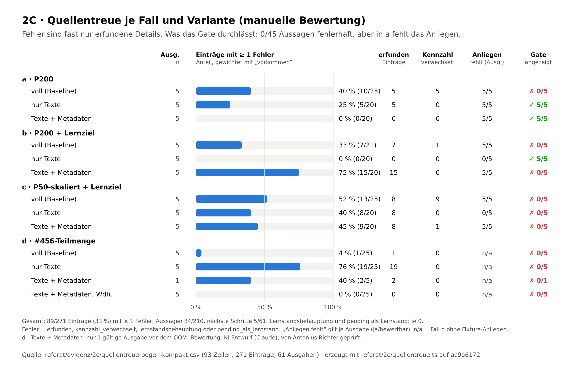

# Auftrag 2C – Auswertung des Quellentreue-Bogens

Erzeugt mit `npx tsx referat/2c/quellentreue.ts` · Arbeitsstand `ac9a6172` · Produktcode 1.3.0 `efd71b44`.
Quelle: `referat/evidenz/2c/quellentreue-bogen-kompakt.csv` (93 Zeilen, 271 Einträge, 61 Ausgaben).
**Bewertung: KI-Entwurf (Claude), von Antonius Richter geprüft.**

## Prüfung des Bogens

- LF-Zeilenenden, 93 Datenzeilen mit gleicher Feldzahl wie der Kopf.
- `erfunden`, `kennzahl_verwechselt`, `lernstandsbehauptung`, `pending_als_lernstand`: in allen 93 Zeilen `ja` oder `nein`.
- `anliegen_fehlt` ist je **Ausgabe** bewertet und nur bei `statement` Nr. 1 eingetragen (`ja`/`nein`/`n/a`), in den übrigen Zeilen leer. Jede der 61 Ausgaben hat genau einen Wert.
- Summe `vorkommen` = 271 = Zeilen der Langfassung `quellentreue-bogen.csv`; jede Zeile hat so viele `lauf_ids` wie `vorkommen`.
- Die Spalten außer den Fehlerklassen und `bemerkung` sind gegenüber der leeren Fassung unverändert.

## Zählweise

- Ein **Eintrag** ist eine Aussage (`statement`) oder ein nächster Schritt (`suggestedNextStep`) einer Ausgabe. Jede Bogenzeile zählt `vorkommen`-fach.
- **≥ 1 Fehler**: mindestens eine der Klassen `erfunden`, `kennzahl_verwechselt`, `lernstandsbehauptung`, `pending_als_lernstand` ist `ja`.
- **Anliegen fehlt** (ja / nein / n/a) zählt Ausgaben, nicht Einträge. n/a: Fall d hat kein vorgegebenes Anliegen der Fixture.
- **Gate angezeigt** = `gate_ok = true`, d. h. das Produkt zeigt den Modelltext statt der Extraktion.

## Je Fall und Variante

| Fall | Variante | Ausgaben | Gate angezeigt | Einträge | ≥ 1 Fehler | Aussagen mit Fehler | nächste Schritte mit Fehler | erfunden | Kennzahl verwechselt | Lernstand | pending als Lernstand | Anliegen fehlt ja / nein / n/a |
| ---- | -------- | -------: | -------------: | -------: | ---------: | ------------------: | --------------------------: | -------: | -------------------: | --------: | --------------------: | ------------------------------ |
| a · P200 | voll (Baseline) | 5 | 0/5 | 25 | 10 (40 %) | 10/20 | 0/5 | 5 | 5 | 0 | 0 | 5 / 0 / 0 |
| a · P200 | nur Texte | 5 | 5/5 | 20 | 5 (25 %) | 0/15 | 5/5 | 5 | 0 | 0 | 0 | 5 / 0 / 0 |
| a · P200 | Texte + Metadaten | 5 | 5/5 | 20 | 0 (0 %) | 0/15 | 0/5 | 0 | 0 | 0 | 0 | 5 / 0 / 0 |
| b · P200 + Lernziel | voll (Baseline) | 5 | 0/5 | 21 | 7 (33 %) | 7/16 | 0/5 | 7 | 1 | 0 | 0 | 5 / 0 / 0 |
| b · P200 + Lernziel | nur Texte | 5 | 5/5 | 20 | 0 (0 %) | 0/15 | 0/5 | 0 | 0 | 0 | 0 | 0 / 5 / 0 |
| b · P200 + Lernziel | Texte + Metadaten | 5 | 0/5 | 20 | 15 (75 %) | 15/15 | 0/5 | 15 | 0 | 0 | 0 | 5 / 0 / 0 |
| c · P50-skaliert + Lernziel | voll (Baseline) | 5 | 0/5 | 25 | 13 (52 %) | 13/20 | 0/5 | 8 | 9 | 0 | 0 | 5 / 0 / 0 |
| c · P50-skaliert + Lernziel | nur Texte | 5 | 0/5 | 20 | 8 (40 %) | 8/15 | 0/5 | 8 | 0 | 0 | 0 | 0 / 5 / 0 |
| c · P50-skaliert + Lernziel | Texte + Metadaten | 5 | 0/5 | 20 | 9 (45 %) | 9/15 | 0/5 | 8 | 1 | 0 | 0 | 5 / 0 / 0 |
| d · #456-Teilmenge | voll (Baseline) | 5 | 0/5 | 25 | 1 (4 %) | 1/20 | 0/5 | 1 | 0 | 0 | 0 | 0 / 0 / 5 |
| d · #456-Teilmenge | nur Texte | 5 | 0/5 | 25 | 19 (76 %) | 19/20 | 0/5 | 19 | 0 | 0 | 0 | 0 / 0 / 5 |
| d · #456-Teilmenge | Texte + Metadaten | 1 | 0/1 | 5 | 2 (40 %) | 2/4 | 0/1 | 2 | 0 | 0 | 0 | 0 / 0 / 1 |
| d · #456-Teilmenge | Texte + Metadaten, Wdh. | 5 | 0/5 | 25 | 0 (0 %) | 0/20 | 0/5 | 0 | 0 | 0 | 0 | 0 / 0 / 5 |

## Gesamt und nach Gate

| Menge | Ausgaben | Einträge | ≥ 1 Fehler | Aussagen mit Fehler | nächste Schritte mit Fehler | erfunden | Kennzahl verwechselt | Anliegen fehlt ja / nein / n/a |
| ----- | -------: | -------: | ---------: | ------------------: | --------------------------: | -------: | -------------------: | ------------------------------ |
| alle | 61 | 271 | 89 (33 %) | 84/210 (40 %) | 5/61 (8 %) | 78 | 16 | 35 / 10 / 16 |
| Gate bestanden (angezeigt) | 15 | 60 | 5 (8 %) | 0/45 (0 %) | 5/15 (33 %) | 5 | 0 | 10 / 5 / 0 |
| Gate abgelehnt (Extraktion angezeigt) | 46 | 211 | 84 (40 %) | 84/165 (51 %) | 0/46 (0 %) | 73 | 16 | 25 / 5 / 16 |

## Abbildung

`referat/evidenz/abbildungen/2c/quellentreue-fehler.png` (PNG 300 dpi, 2667 × 1667; SVG daneben).
