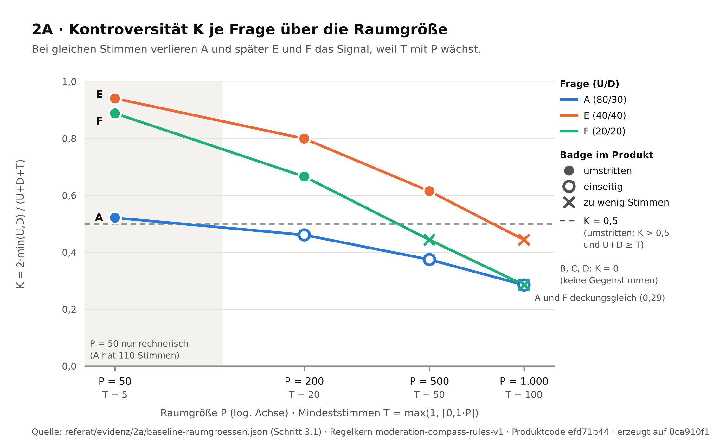

# Abbildungen 2A

Erzeugt mit `npx tsx referat/2a/abbildungen.ts` · Arbeitsstand `0ca910f1` · Produktcode 1.3.0 `efd71b44` · Rohdaten erzeugt auf `905250f2` · PNG 300 dpi, SVG daneben als Quelle.

## k-werte-raumgroessen.png

- **Datenquelle:** `referat/evidenz/2a/baseline-raumgroessen.json` (Schritt 3.1, echte Regelfunktionen; K nach `qaRankingSql.ts`).
- **Darstellung:** K der Fragen A, E, F über P = 50/200/500/1000 (log. Achse). B, C, D haben keine Gegenstimmen und daher K = 0 bei jedem P; sie sind nicht gezeichnet. Die Markerform zeigt das Badge des Produkts: gefüllt = umstritten, Ring = einseitig, Kreuz = zu wenig Stimmen (U+D < T).
- **P = 50** ist grau hinterlegt: rechnerisch, aber nicht realisierbar (A hat 110 Stimmen bei 50 Teilnehmenden). Der realisierbare Fall „P50-skaliert“ steht in `referat/evidenz/2a/p50-skaliert.md` und ist hier nicht eingezeichnet.
- Bei P = 1000 liegen A und F mit K = 0,2857 genau übereinander.
- Abweichung zum Plan (§0.2): K(A) bei P = 1000 im Plan 0,27, gemessen 0,29 (exakt 0,285714).

Datentabelle (Werte der Abbildung):

| P | T | K(A) · Badge | K(B) · Badge | K(C) · Badge | K(D) · Badge | K(E) · Badge | K(F) · Badge | Karte friction |
| -: | -: | ---- | ---- | ---- | ---- | ---- | ---- | ---- |
| 50 | 5 | 0,5217 · controversial | 0,0000 · onesided | 0,0000 · onesided | 0,0000 · onesided | 0,9412 · controversial | 0,8889 · controversial | E, F, A |
| 200 | 20 | 0,4615 · onesided | 0,0000 · insufficient | 0,0000 · onesided | 0,0000 · insufficient | 0,8000 · controversial | 0,6667 · controversial | E, F |
| 500 | 50 | 0,3750 · onesided | 0,0000 · insufficient | 0,0000 · insufficient | 0,0000 · insufficient | 0,6154 · controversial | 0,4444 · insufficient | E |
| 1000 | 100 | 0,2857 · onesided | 0,0000 · insufficient | 0,0000 · insufficient | 0,0000 · insufficient | 0,4444 · insufficient | 0,2857 · insufficient | – |

Pixelmaß: 2250 × 1417.
