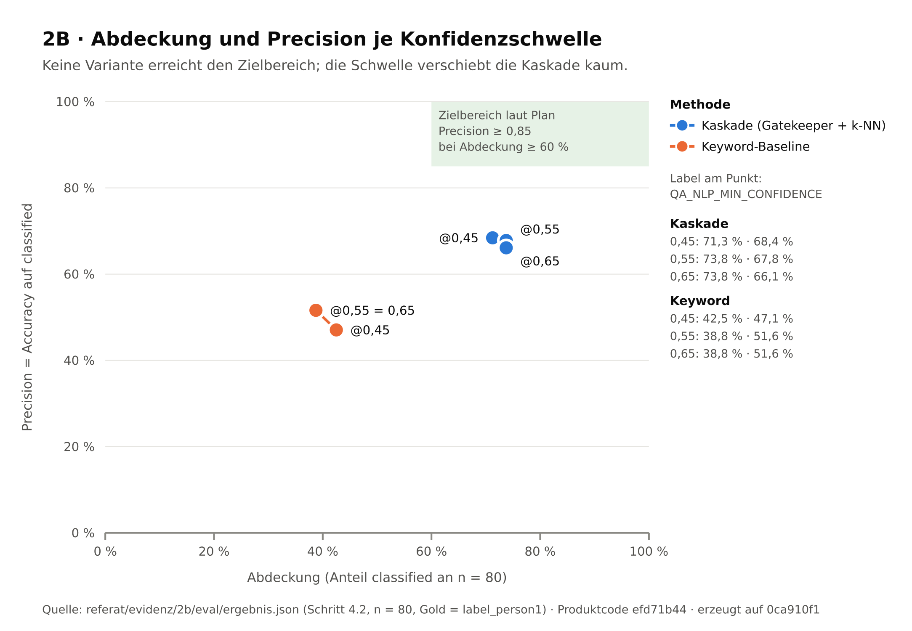
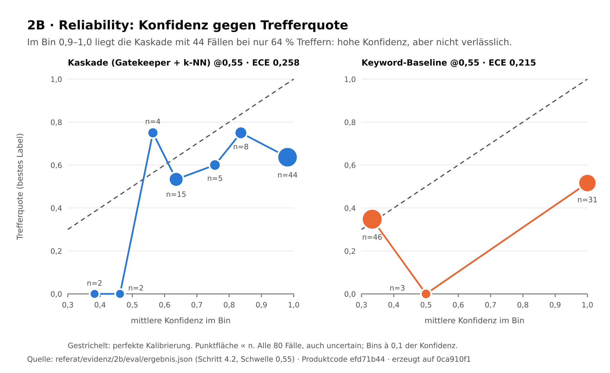

# Abbildungen 2B

Erzeugt mit `npx tsx referat/2b/abbildungen.ts` · Arbeitsstand `0ca910f1` · Produktcode 1.3.0 `efd71b44` · PNG 300 dpi, SVG daneben als Quelle.
Datenquelle beider Abbildungen: `referat/evidenz/2b/eval/ergebnis.json` (Schritt 4.2, `npx tsx referat/2b/eval.ts`), Referenzmenge `referat/2b/referenz.csv` mit n = 80, Gold = `label_person1` (eine labelnde Person).

## abdeckung-precision-schwellen.png

- x = Abdeckung (Anteil classified), y = Accuracy auf classified (im Plan „Precision auf classified“). Je Methode drei Punkte für `QA_NLP_MIN_CONFIDENCE` = 0,45 / 0,55 / 0,65, in dieser Reihenfolge verbunden.
- Grün hinterlegt: Zielbereich aus dem Plan (Precision ≥ 0,85 bei Abdeckung ≥ 60 %).
- Keyword @0,55 und @0,65 sind identisch und als ein Punkt beschriftet. Die Kaskade wird von 0,45 auf 0,55 *abdeckender* (nicht monoton, siehe `ergebnis.md` Beobachtung 4).

| Variante | classified | Abdeckung | Accuracy (classified) |
| -------- | ---------: | --------: | --------------------: |
| kaskade@0.45 | 57/80 | 71,3 % | 68,4 % |
| kaskade@0.55 | 59/80 | 73,8 % | 67,8 % |
| kaskade@0.65 | 59/80 | 73,8 % | 66,1 % |
| keyword@0.45 | 34/80 | 42,5 % | 47,1 % |
| keyword@0.55 | 31/80 | 38,8 % | 51,6 % |
| keyword@0.65 | 31/80 | 38,8 % | 51,6 % |

## reliability.png

- Zwei Panels mit gleicher Skala: Kaskade und Keyword-Baseline bei der Default-Schwelle 0,55. Je Konfidenz-Bin (Breite 0,1) mittlere Konfidenz gegen Trefferquote des besten Labels, über alle Fälle einschließlich uncertain (wie in `ergebnis.md`). Leere Bins sind nicht gezeichnet.
- Punktfläche proportional zu n; die Diagonale ist perfekte Kalibrierung.

| Variante | Bin | n | davon classified | mittlere Konfidenz | Trefferquote |
| -------- | --- | -: | ---------------: | -----------------: | -----------: |
| kaskade@0.55 | 0.3–0.4 | 2 | 0 | 0,383 | 0,000 |
| kaskade@0.55 | 0.4–0.5 | 2 | 0 | 0,462 | 0,000 |
| kaskade@0.55 | 0.5–0.6 | 4 | 0 | 0,564 | 0,750 |
| kaskade@0.55 | 0.6–0.7 | 15 | 14 | 0,636 | 0,533 |
| kaskade@0.55 | 0.7–0.8 | 5 | 4 | 0,756 | 0,600 |
| kaskade@0.55 | 0.8–0.9 | 8 | 7 | 0,836 | 0,750 |
| kaskade@0.55 | 0.9–1.0 | 44 | 34 | 0,981 | 0,636 |
| keyword@0.55 | 0.3–0.4 | 46 | 0 | 0,333 | 0,348 |
| keyword@0.55 | 0.5–0.6 | 3 | 0 | 0,500 | 0,000 |
| keyword@0.55 | 0.9–1.0 | 31 | 31 | 1,000 | 0,516 |

Pixelmaße: abdeckung-precision-schwellen.png 2167 × 1500, reliability.png 2250 × 1375.
