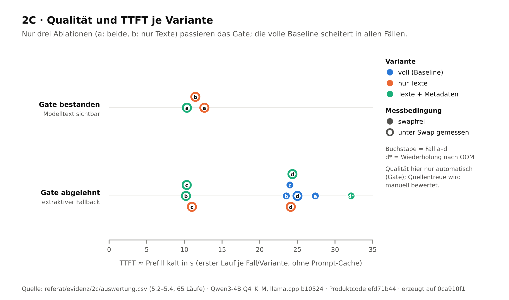
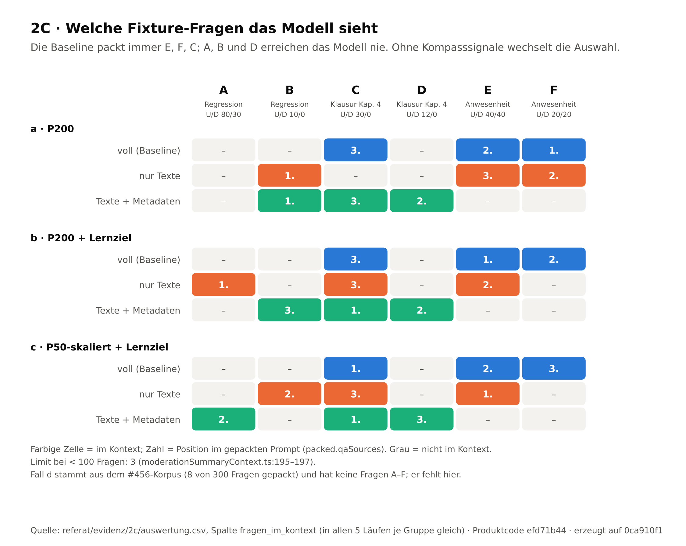
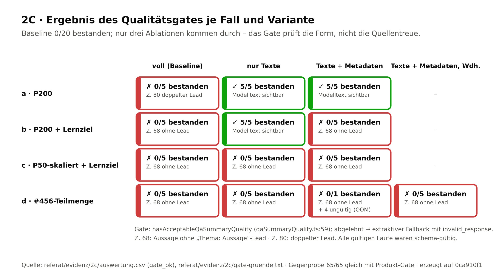
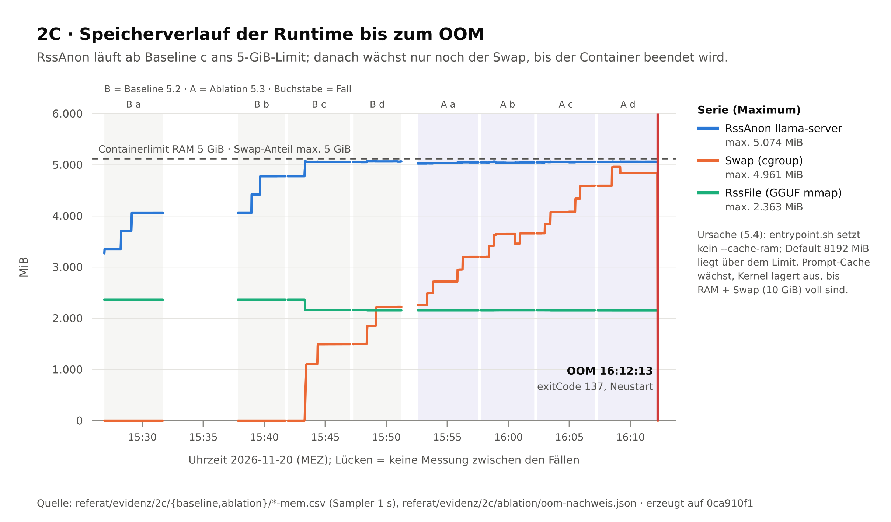
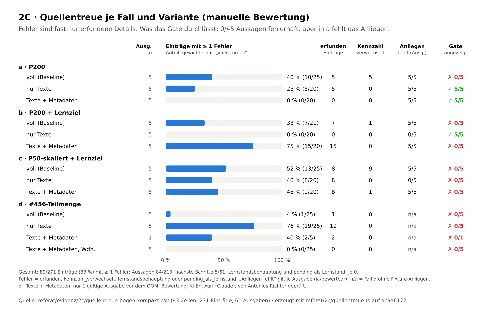

# Abbildungen 2C

Erzeugt mit `npx tsx referat/2c/abbildungen.ts` · Arbeitsstand `0ca910f1` · Produktcode 1.3.0 `efd71b44` · Runtime llama.cpp b10524, Qwen3-4B-Instruct-2507 Q4_K_M (Manifest) · PNG 300 dpi, SVG daneben als Quelle.

## qualitaet-ttft.png

- **Datenquelle:** `referat/evidenz/2c/auswertung.csv` (5.4). Je Fall/Variante der erste, kalte Lauf (`kalt = true`, `prefill_art = kalt`); `prefill_ms` als Näherung für TTFT (Zeit bis zum ersten Token ≈ Prefill). Gate-Anteil über alle gültigen Läufe der Gruppe.
- **Qualität** ist hier nur das automatische Produkt-Gate (`gate_ok`). Die Quellentreue ist manuell bewertet (`quellentreue-bogen-kompakt.csv`) und nicht Teil dieser Abbildung; Auswertung in `quellentreue-fehler.png` (unten).
- Hohl = erster Lauf unter Swap gemessen (`unter_swap`); diese Zeiten sind nicht mit swapfreien vergleichbar. d* = Wiederholung nach OOM-Neustart (swapfrei, aber langsamer; Ursache nicht belegt, siehe `auswertung.md`).

| Fall | Variante | Prefill kalt (s) | Gate bestanden | Messbedingung Lauf 1 |
| ---- | -------- | ---------------: | -------------: | -------------------- |
| a · P200 | voll | 27,4 | 0/5 | swapfrei |
| a · P200 | nur-texte | 12,7 | 5/5 | unter Swap |
| a · P200 | texte-metadaten | 10,3 | 5/5 | unter Swap |
| b · P200 + Lernziel | voll | 23,5 | 0/5 | swapfrei |
| b · P200 + Lernziel | nur-texte | 11,5 | 5/5 | unter Swap |
| b · P200 + Lernziel | texte-metadaten | 10,2 | 0/5 | unter Swap |
| c · P50-skaliert + Lernziel | voll | 24,0 | 0/5 | swapfrei |
| c · P50-skaliert + Lernziel | nur-texte | 11,0 | 0/5 | unter Swap |
| c · P50-skaliert + Lernziel | texte-metadaten | 10,3 | 0/5 | unter Swap |
| d · #456-Teilmenge | voll | 25,0 | 0/5 | unter Swap |
| d · #456-Teilmenge | nur-texte | 24,1 | 0/5 | unter Swap |
| d · #456-Teilmenge | texte-metadaten | 24,3 | 0/1 | unter Swap |
| d · #456-Teilmenge | texte-metadaten (Wdh. nach OOM-Neustart) | 32,1 | 0/5 | swapfrei |

## fragen-im-kontext.png

- **Datenquelle:** `referat/evidenz/2c/auswertung.csv`, Spalte `fragen_im_kontext` (= `packed.qaSources` in Reihenfolge des Prompts). In allen 5 gültigen Läufen je Gruppe identisch.
- Fall d (#456-Korpus) hat keine Fixture-Fragen A–F und ist nicht dargestellt.

| Fall | Variante | im Kontext (Reihenfolge) | nicht im Kontext |
| ---- | -------- | ------------------------ | ---------------- |
| a · P200 | voll (Baseline) | F, E, C | A, B, D |
| a · P200 | nur Texte | B, F, E | A, C, D |
| a · P200 | Texte + Metadaten | B, D, C | A, E, F |
| b · P200 + Lernziel | voll (Baseline) | E, F, C | A, B, D |
| b · P200 + Lernziel | nur Texte | A, E, C | B, D, F |
| b · P200 + Lernziel | Texte + Metadaten | C, D, B | A, E, F |
| c · P50-skaliert + Lernziel | voll (Baseline) | C, E, F | A, B, D |
| c · P50-skaliert + Lernziel | nur Texte | E, B, C | A, D, F |
| c · P50-skaliert + Lernziel | Texte + Metadaten | C, A, D | B, E, F |

## gate-ergebnis.png

- **Datenquelle:** `referat/evidenz/2c/auswertung.csv` (`gate_ok`, `gueltig`) und `referat/evidenz/2c/gate-gruende.txt` (erste verletzte Bedingung, `referat/2c/gate-gruende.py`).
- Status mit Symbol und Text (✓/✗), nicht nur über Farbe.

| Fall | Variante | Ergebnis | Grund |
| ---- | -------- | -------- | ----- |
| a · P200 | voll (Baseline) | 0/5 bestanden | Z. 80 doppelter Lead |
| a · P200 | nur Texte | 5/5 bestanden | Modelltext sichtbar |
| a · P200 | Texte + Metadaten | 5/5 bestanden | Modelltext sichtbar |
| b · P200 + Lernziel | voll (Baseline) | 0/5 bestanden | Z. 68 ohne Lead |
| b · P200 + Lernziel | nur Texte | 5/5 bestanden | Modelltext sichtbar |
| b · P200 + Lernziel | Texte + Metadaten | 0/5 bestanden | Z. 68 ohne Lead |
| c · P50-skaliert + Lernziel | voll (Baseline) | 0/5 bestanden | Z. 68 ohne Lead |
| c · P50-skaliert + Lernziel | nur Texte | 0/5 bestanden | Z. 68 ohne Lead |
| c · P50-skaliert + Lernziel | Texte + Metadaten | 0/5 bestanden | Z. 68 ohne Lead |
| d · #456-Teilmenge | voll (Baseline) | 0/5 bestanden | Z. 68 ohne Lead |
| d · #456-Teilmenge | nur Texte | 0/5 bestanden | Z. 68 ohne Lead |
| d · #456-Teilmenge | Texte + Metadaten | 0/1 bestanden | Z. 68 ohne Lead + 4 ungültig (OOM) |
| d · #456-Teilmenge | Texte + Metadaten, Wdh. | 0/5 bestanden | Z. 68 ohne Lead |

## speicher-bis-oom.png

- **Datenquelle:** Sampler `*-mem.csv` (1 s; RssAnon/RssFile aus `/proc/<llama-server>/status`, Swap = cgroup `memory.swap.current`). OOM-Zeitpunkt = Container-Neustart `StartedAt` 2026-11-20T15:12:13.594077174Z aus `referat/evidenz/2c/ablation/oom-nachweis.json` (docker events live abgelesen, siehe Protokoll 5.3).
- Gezeigt sind 5.2 und 5.3 bis zum OOM. Die Wiederholung von d nach dem Neustart (19:33–19:37 MEZ, RssAnon max. 3 783 MiB, Swap 0) und die Probe 5.1 sind nicht eingezeichnet.

| Abschnitt | Datei | Zeit (MEZ) | RssAnon max (MiB) | Swap max (MiB) | RssFile max (MiB) |
| --------- | ----- | ---------- | ----------------: | -------------: | ----------------: |
| B a | `referat/evidenz/2c/baseline/a-P200-mem.csv` | 15:26–15:31 | 4.060 | 0 | 2.363 |
| B b | `referat/evidenz/2c/baseline/b-P200-lernziel-mem.csv` | 15:37–15:41 | 4.777 | 0 | 2.363 |
| B c | `referat/evidenz/2c/baseline/c-P50skaliert-lernziel-mem.csv` | 15:41–15:47 | 5.072 | 1.496 | 2.363 |
| B d | `referat/evidenz/2c/baseline/d-456-teilmenge-mem.csv` | 15:47–15:51 | 5.074 | 2.224 | 2.163 |
| A a | `referat/evidenz/2c/ablation/a-P200-mem.csv` | 15:52–15:57 | 5.050 | 3.202 | 2.156 |
| A b | `referat/evidenz/2c/ablation/b-P200-lernziel-mem.csv` | 15:57–16:02 | 5.065 | 3.660 | 2.158 |
| A c | `referat/evidenz/2c/ablation/c-P50skaliert-lernziel-mem.csv` | 16:02–16:07 | 5.062 | 4.592 | 2.158 |
| A d | `referat/evidenz/2c/ablation/d-456-teilmenge-mem.csv` | 16:07–16:12 | 5.063 | 4.961 | 2.155 |

## quellentreue-fehler.png

- Erzeugt mit `npx tsx referat/2c/quellentreue.ts` (eigenes Skript, nicht Teil von `referat/2c/abbildungen.ts`); Tabellen und Zählweise in `referat/evidenz/2c/quellentreue-auswertung.md`.
- **Datenquelle:** `referat/evidenz/2c/quellentreue-bogen-kompakt.csv` (Bewertung: KI-Entwurf von Claude, von Antonius Richter geprüft).

Pixelmaße: qualitaet-ttft.png 2333 × 1375, fragen-im-kontext.png 2250 × 1792, gate-ergebnis.png 2333 × 1283, speicher-bis-oom.png 2417 × 1417.
